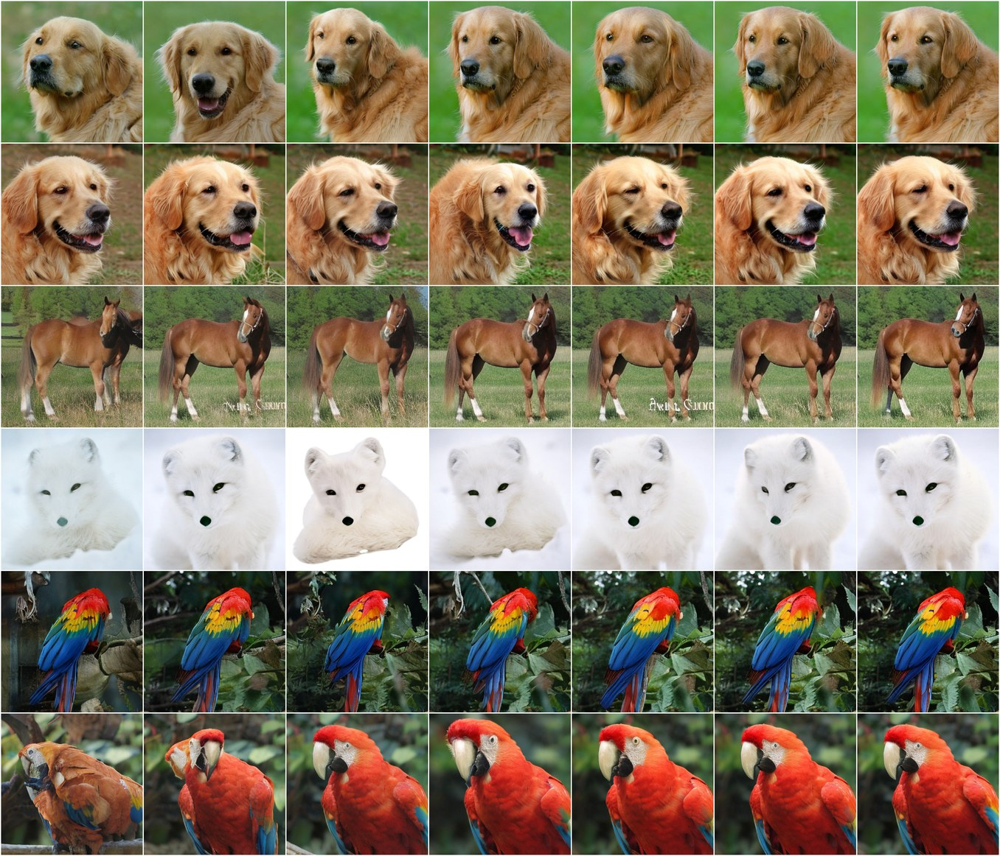

<div align="center">
<h1> Improved Training of Strong Stochastic Flow Maps </h1>

[Zander W. Blasingame](https://zblasingame.github.io) &emsp; <b>&middot;</b> &emsp; [Antonio Franca](https://www.antoniofranca.me/) &emsp; <b>&middot;</b> &emsp; [Raúl Miñán](https://scholar.google.com/citations?user=osrdVCEAAAAJ&hl=en)<br>
[Christian Koke](https://christiankoke.github.io/) &emsp; <b>&middot;</b> &emsp; [Niklas Rindtorff](https://www.rindtorff.xyz/) &emsp; <b>&middot;</b> &emsp; [Alexander Tong](https://www.alextong.net/)

[](https://arxiv.org/abs/2610.29605)
[](https://huggingface.co/zblasingame/improved-strong-stochastic-flow-maps)
</div>

<p align="center">

</p>

<p align="center"><em>iSSFM on ImageNet-256: rollouts at 4, 6, 8, 10, 12, 14 and 16 NFE (left to right).
Each row shares one initial noise and one realization of the Brownian path, so the images converge strongly.</em></p>

## Summary

Official implementation of **Improved Training of Strong Stochastic Flow Maps**
(iSSFM).
A strong stochastic flow map learns the pathwise solution map of an SDE,
jumping directly between times along a given Brownian path.
We unlock derivative-based training with losses like the improved MeanFlow (iMF) loss
via a Wong--Zakai styled construction, and we also improve the parameterization of the flow map,
along with other details described in the paper.
We include the code to reproduce the main experiments.

## Installation

Requires Python 3.12, [uv](https://docs.astral.sh/uv/) and an NVIDIA GPU for the
ImageNet experiments.
PyTorch is installed from the CUDA 13.0 (`cu130`) wheel index; edit `[tool.uv.sources]` in
`pyproject.toml` for a different CUDA version.

```bash
git clone https://github.com/zblasingame/improved-strong-stochastic-flow-maps && cd improved-strong-stochastic-flow-maps
uv sync
cp .env.example .env   # then set SCRATCH_DIR / DATA_DIR
```

All paths are read from environment variables (or `.env`); see `.env.example`.
The scripts in `scripts/` are plain bash and run from any directory; on a cluster,
wrap them in your scheduler (e.g. `sbatch --gres=gpu:1 scripts/imagenet/train.sh wz_imf`).
Training logs to Weights & Biases by default; set `LOGGER=csv` to log locally.

## Pretrained models

ImageNet-256 checkpoints are on the Hugging Face Hub at
[zblasingame/improved-strong-stochastic-flow-maps](https://huggingface.co/zblasingame/improved-strong-stochastic-flow-maps):

| Model | Description | FID @ 4 NFE | FD<sub>DINOv2</sub> @ 4 NFE |
| --- | --- | --- | --- |
| `ssfm` | SSFM | 31.00 | 475.1 |
| `ssfm_lift` | + exponential lift | 28.15 | 447.4 |
| `ssfm_lift_martingale` | + closed-form martingale | 18.33 | 301.6 |
| `ssfm_lift_martingale_drift` | + drift matching | 14.67 | 288.1 |
| `issfm` | iSSFM (+ Wong--Zakai iMF loss) | **5.96** | **143.0** |

Every model is fine-tuned from DMF-XL/2+ for 100k steps with $N=3$ shifted Legendre
coefficients.
They contain only the fine-tuned parameters (150–165 MB each) and load on top of the DMF-XL/2+ backbone from
[kyungmnlee/DMF](https://huggingface.co/kyungmnlee/DMF).

```bash
# 1. Download the DMF-XL/2+ backbone (and SiT teacher) into $DATA_DIR/checkpoints.
STEPS=dmf scripts/imagenet/prepare_data.sh

# 2. Sample: weights are fetched from the Hub on first use and cached.
uv run python -m scripts.imagenet.sample --model issfm --labels 339 207 --nfe 1 2 4 8 16
```

This writes `samples.png`, a grid with one row per class label; every NFE in a row uses the
same initial noise and Brownian path, so each row converges to one image.
To download the weights manually, use
`hf download zblasingame/improved-strong-stochastic-flow-maps --local-dir hf_models` and
pass `--model hf_models/issfm`.
To reproduce the table above (50k samples, see
[Evaluate](#imagenet-256)), run `scripts/imagenet/evaluate.sh release <model>`.

## Experiments

Each experiment has one `train.sh` and one `evaluate.sh`:

| Experiment | Train | Evaluate |
| --- | --- | --- |
| Toy 1D non-linear SDE | `scripts/toy1d/train.sh` | `scripts/toy1d/evaluate.sh` |
| ImageNet-256 | `scripts/imagenet/train.sh EXPERIMENT` | `scripts/imagenet/evaluate.sh student RUN_DIR` |
| Feynman--Kac correctors | `scripts/fkc/train.sh` | `scripts/fkc/evaluate.sh` |

Extra arguments to `train.sh` are passed to Hydra, e.g.
`scripts/toy1d/train.sh trainer.max_epochs=10`. The experiment presets live in
`configs/experiment/`.

### Toy 1D non-linear SDE

`dX = (X - X^3) dt + sqrt(beta_t) dW` with `beta` linear from 20 to 0.1. The sweep
trains 9 losses x N in {1, 2, 3, 4} (36 runs, 5k steps each; `TASK_ID=k` runs a single
one), and the evaluation computes the strong error of all runs on one shared
realization (1024 initial conditions and Brownian paths, 512-step Euler--Maruyama
reference) for NFE in {1, ..., 32}.

### ImageNet-256

1. **Data and checkpoints.** `scripts/imagenet/prepare_data.sh`:
   - downloads the DMF-XL/2+ checkpoint (fine-tuning initialization), the
     SiT-XL/2+REPA teacher and the FID reference statistics from
     [kyungmnlee/DMF](https://huggingface.co/kyungmnlee/DMF) into `$DATA_DIR/checkpoints`;
   - downloads `ILSVRC/imagenet-1k` from the Hugging Face Hub (accept the dataset
     terms and set `HF_TOKEN`), and encodes SD-VAE (`sd-vae-ft-mse`) latents;
   - computes the FD-DINOv2 reference statistics.
2. **Train** (one GPU, 100k steps). `EXPERIMENT` selects
   `configs/experiment/imagenet256_<EXPERIMENT>.yaml`. The ablation ladder of
   Table 1 adds one change per rung, from SSFM to iSSFM:

   | `EXPERIMENT` | Paper (Table 1) |
   | --- | --- |
   | `ssfm` | SSFM: learned diffusion head, no lift, Euler--Maruyama diagonal |
   | `ssfm_lift` | + exponential lift |
   | `ssfm_lift_martingale` | + closed-form martingale |
   | `ssfm_lift_martingale_drift` | + drift matching (improved parameterization) |
   | `wz_imf` | iSSFM: + Wong--Zakai iMF loss |

   ```bash
   scripts/imagenet/train.sh wz_imf                      # iSSFM, N=3
   RUN_NAME=wz_imf_n6 scripts/imagenet/train.sh wz_imf model.net.degree=6 \
     model.loss.degree=6 callbacks.sample_grid.degree=6 callbacks.fid.degree=6
   ```
   Each run saves `current.ckpt` (full state at the last evaluation, i.e. step 100k
   at the end) in `$SCRATCH_DIR/logs/train/runs/imagenet256_<EXPERIMENT>/checkpoints`.
3. **Evaluate** on 50k class-balanced samples with fixed seeds (FID, FD-DINOv2,
   ImageReward, PickScore, HPSv2.1) at NFE 1, 2, 4, 8, 16:
   ```bash
   scripts/imagenet/evaluate.sh student $SCRATCH_DIR/logs/train/runs/imagenet256_wz_imf
   scripts/imagenet/evaluate.sh teacher   # SiT-XL/2+REPA, Euler-Maruyama SDE
   scripts/imagenet/rollout_grid.sh $SCRATCH_DIR/logs/train/runs/imagenet256_wz_imf
   ```
   Set `NUM_TASKS=<num GPUs>` to split generation. Scoring runs in a separate
   pinned environment (`scripts/imagenet/scoring_env`, Python 3.11, created on first
   use) because the preference models require old library versions.

### Feynman--Kac correctors

`scripts/fkc/train.sh` trains the augmented iSSFM on the annealed (beta = 3)
40-Gaussian mixture and a diffusion baseline (CPU is enough); `scripts/fkc/evaluate.sh`
produces the metrics, the log-weight clipping sweep and LaTeX tables, and the panel
data under `results/fkc/`.

## Repository layout

```text
src/
  train.py                          Hydra / Lightning entry point
  models/
    ssfm_module.py                  Base Lightning module (EMA teacher, optimization)
    wz_module.py, ei_euler_module.py, ei_doss_module.py
                                    ImageNet modules (WZ-iMF, semigroup ladder)
    fkc_module.py                   Augmented FKC flow map
    components/
      brownian.py                   Shifted Legendre Brownian polynomials, Chen relations
      ei_doss.py, ei_euler.py       Exponentially lifted maps and closed-form martingales
      fixed_coefficient_ssfm.py     DMF-XL/2 student with Brownian-coefficient injection
      ablation_map.py               SSFM ablation-ladder steps (learned noise, no lift)
      losses/                       WZ-iMF, semigroup (+ ladder) and toy-1D losses
      samplers.py                   Few-step strong samplers
      fkc/                          FKC problem, network, loss, sampling
  data/                             Latent ImageNet, toy-1D and FKC data modules
  evaluation/                       Sample plans, FID/FD, pretrained-model loading
configs/                            Hydra configs (experiment/ holds the paper presets)
scripts/
  toy1d/, imagenet/, fkc/           train.sh / evaluate.sh and their Python helpers
  imagenet/sample.py                Sampling from released models
```

## Citation

If you find this code useful in your research, please cite the following paper (expand for BibTeX):

<details>
<summary>
Z.W. Blasingame, A. Franca, R. Miñán, C. Koke, N. Rindtorff, A. Tong. Improved Training of Strong Stochastic Flow Maps, 2026.
</summary>

```bibtex
@misc{blasingame2026improved,
  title={Improved Training of Strong Stochastic Flow Maps},
  author={Blasingame, Zander W. and Franca, Antonio and Mi{\~n}{\'a}n, Ra{\'u}l and Koke, Christian and Rindtorff, Niklas and Tong, Alexander},
  year={2026},
  eprint={2610.29605},
  archivePrefix={arXiv},
  primaryClass={cs.LG},
  url={https://arxiv.org/abs/2610.29605}
}
```
</details>

This work builds on our NeurIPS 2026 oral *Strong Stochastic Flow Maps*:
* arXiv: [2606.01086](https://arxiv.org/abs/2606.01086)
* github: [sammccallum/ssfm](https://github.com/sammccallum/ssfm)

## Acknowledgements

The ImageNet experiments fine-tune DMF-XL/2+ from [Lee et al. (2025)](https://github.com/kyungmnlee/dmf),
and the Feynman--Kac corrector experiments follow [Skreta et al. (2025)](https://arxiv.org/abs/2503.02819).

## License

Code and released weights are under the [MIT License](LICENSE).
